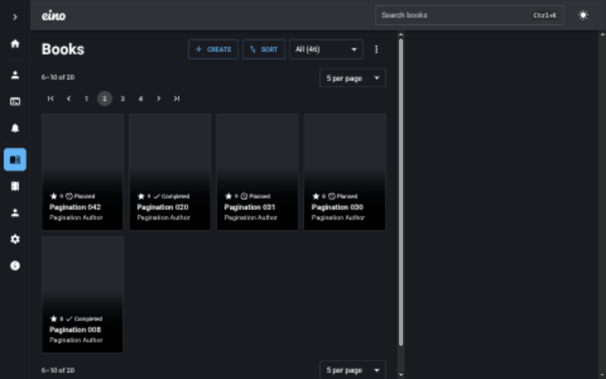
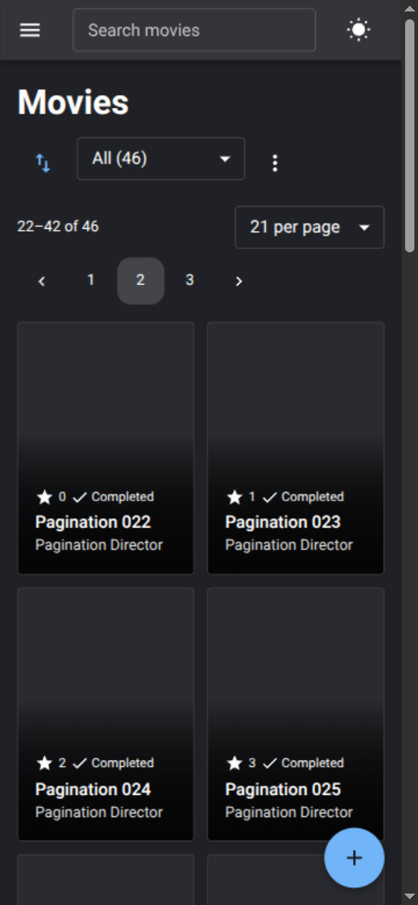

# v2 list pagination

## Rollout dependency

This frontend requires the opt-in pagination contract from [eino-backend PR #6](https://github.com/Jankku/eino-backend/pull/6), branch `feat/v2-list-pagination`, implementation commit `66fd5045ffd0321b6bef4827dfb4e89b89383944`. The PR was still open and unmerged when verified on November 1, 2026; do not assume it is deployed.

Before releasing this frontend:

1. Deploy a backend implementing the documented contract in `src/docs-v2.yaml`.
2. Apply backend migration `1793491200000_list-pagination`. It creates PostgreSQL ICU collation `eino_list_en` and the `(created_on, id)` audit index. Keep ICU ordering; a frontend re-sort is not a substitute. PostgreSQL must support ICU. For local development, build the backend and run `npm run migrate:dev -- up` against the intended development database.
3. Smoke-test paginated `/api/v2/list/books/all`, `/api/v2/list/movies/all`, both status routes, and all three admin endpoints against the actual deployment.
4. Build this frontend with `VITE_BASE_URL` pointing to that compatible backend.

**Observed upstream regression:** backend PR head `bc12a85b028785698131cb13d4a4435c137e9850` returned 422 for paginated book/movie `/all` requests even after the migration. Its `fetchPage` handlers read `input.params.status` on `/all`, where that input is absent. The reference implementation commit guards this access and passes the same requests. Fix/recheck the backend PR head before rollout; this frontend does not hide that failure by fetching whole lists or bypassing `/all`.

A backend that ignores pagination and returns only `{ results }` is reported through the existing error boundary, rather than silently displaying the complete collection as one page.

## Behavior and compatibility

- Book/movie lists default to 21 rows, matching the existing layout; admin tables default to 25. The selector offers 21, 25, 50 and 100, and preserves other valid sizes from shared URLs.
- `page` and `pageSize` are URL-backed, positive whole integers, with `pageSize <= 100`. Invalid URL values normalize to safe defaults before requests. API pages are one-based; DataGrid models are zero-based.
- Book/movie `status`, `sort`, `order`, `filter`, `page` and `pageSize` all participate in page cache keys. Sort/order/filter are sent to the backend before pagination; the frontend neither slices nor re-sorts the returned rows. An absent filter is omitted, not sent as the invalid empty paginated filter.
- Existing URL filters retain the backend `key:operator:value` syntax. The app's existing search fields still use their separate, unpaginated search endpoints; they are not repurposed as page-local filtering controls.
- Changing status, sort/order, filters or page size resets to page 1. Ordinary page navigation preserves the other query parameters. Links, browser history and detail links retain the query string.
- Empty filtered/status collections show a useful message and the actual server total. Out-of-range pages, including a last page emptied by a mutation, recover to the last valid page (or page 1 when `totalPages = 0`). Existing mutation invalidation prefixes include every page and full-list variant.
- Admin ordering is fixed by the API: users by username ascending; audits/bulletins by created time ascending, then ID ascending. Grid sorting, filtering and quick filters are disabled. CSV/print toolbar actions are disabled rather than implying that a single fetched page is the full table. Column visibility and row editing/actions remain available.
- Status totals still come from the independent count endpoints, not page length. Profile/statistics dialogs and the Copy action still request complete matching lists under separate `full` cache keys. Bulletin recipient lookup also retains its complete user list. Detail, export/import and v1 endpoints are unchanged.
- Existing suspense/error boundaries handle initial loads/errors; background refetches show progress and retain the existing error snackbar. Pagination has labeled navigation, current-page state, a labeled page-size selector and an announced result range. Mobile navigation uses 44-pixel targets and omits first/last shortcuts to fit narrow screens.

## Verification observed November 1, 2026

Checks: `npm run lint`, `npm run typecheck`, `npm run test:unit`, `npm run build`, and `git diff --check`. No end-to-end tests were added or run; the repository's old E2E suite is intentionally excluded. Focused unit tests cover URL validation/preservation, page resets before fetching, mutation/out-of-range recovery, response handling, and separation of page/full-list/count caches.

Runtime verification used an isolated backend export of implementation commit `66fd5045` on localhost port 5001 and frontend port 3001. Existing servers on ports 5000/3000, the backend checkout branch and `.env` files were left untouched. The database host was verified as localhost; the one pending ICU migration was inspected with a dry run before being applied locally. No production service was contacted or changed.

Test-owned development fixtures supplied 46 books and 46 movies, plus enough users and expired bulletins to exercise multiple admin pages. Those fixtures were removed afterward; the migration remains applied locally. Observed evidence:

| Scenario | Observed result |
| --- | --- |
| Books and movies, default size, page 2 | Request includes `page=2&pageSize=21`; 21 returned rows; range `22–42 of 46` |
| Global score filter/sort, page 2, size 5 | `filter=score:>:5`, score descending; 5 rows; matching total 20; range `6–10 of 20` |
| Complete traversal | Three pages contain all 46 distinct IDs, in title order, without overlap |
| Status and page-size changes | Page 1 is fetched; whole-list status counts remain 46 / 25 completed / 21 planned |
| Users, audits and bulletins | Bounded page requests with server totals, disjoint pages, no sort/filter UI |
| Delete the sole bulletin on page 28, size 1 | Mutation invalidates page 28; empty response triggers page 27; range becomes `27–27 of 27` |
| Empty filter requested at page 99 | URL recovers to page 1; `0–0 of 0`; useful empty-filter message; status totals still show 46 |
| Full-list consumers and search API | Unpaginated filtered results retain all matches; search returns all 46 fixture matches; no pagination metadata |
| Invalid API page/page size | Backend returns 422 |
| Error handling | Incompatible local backend produces the existing error page with Try again rather than partial/incorrect totals |
| Mobile | Page-size change resets to page 1; navigation fits 390-pixel viewport; 44-pixel paging targets |

### Desktop: globally sorted and filtered page

### Mobile: second movie page, full-list count preserved

